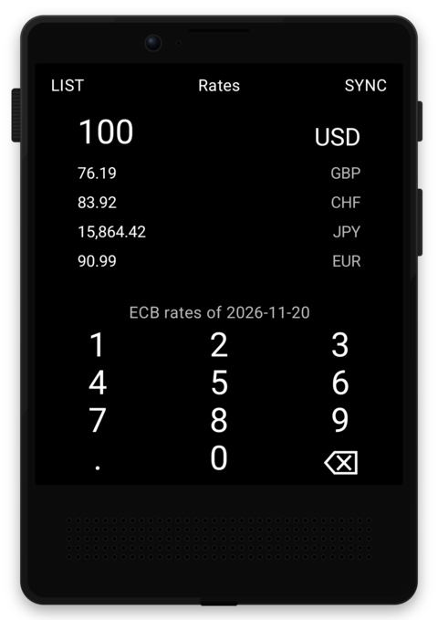
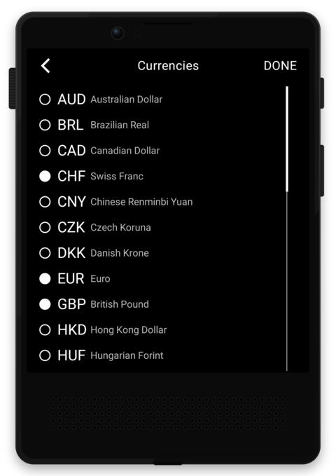

# Rates

A currency converter for the Light Phone III. Type an amount and see it in the currencies you care about.

<p align="center">
  
  
</p>

- Type an amount on the keypad and it's converted into each of your currencies as you type. Tap the amount to clear it.
- Tap a currency in the list to make it the one you type in.
- **LIST** picks which of the 30 currencies to show. **SYNC** downloads the latest rates.
- Rates are the European Central Bank's reference rates, via [Frankfurter](https://frankfurter.dev) (free, no key, no account). They refresh in the background about twice a day and are stored on the phone, so Rates works offline with the last rates it saved. The date of those rates is shown above the keypad.

## Privacy

No account, no tracking, no analytics, no ads. The only network request is the rates download from `api.frankfurter.dev`, which sends nothing about you or what you convert. Your currencies and the saved rates stay on the phone.

## License

MIT, see `LICENSE`.

## Build

This repo holds only the `tool/` module. Copy it into a checkout of [light-sdk](https://github.com/lightphone/light-sdk), replacing its `tool/`, then:

```sh
./gradlew :tool:testDebugUnitTest :tool:assembleRelease
```
